# Sơ Đồ Thực Thể Quan Hệ (ERD) - Vegetarian Support System

File PlantUML gốc: [`erd.puml`](./erd.puml) (Dùng cho PlantText, Draw.io, VS Code PlantUML Extension).

Dưới đây là sơ đồ Mermaid ERD kết xuất trực tiếp để xem nhanh trên Markdown / GitHub:

```mermaid
erDiagram
    Users ||--o| UserProfiles : "1-1 hồ sơ"
    Users ||--o{ UserAllergies : "dị ứng"
    Users ||--o{ UserAvoidedFoods : "tránh ăn"
    Users ||--o{ PasswordResetTokens : "reset token"
    Users ||--o{ MemberStatusChanges : "trạng thái khóa"
    Users ||--o{ PantryItems : "sở hữu"
    Users ||--o{ Favorites : "lưu yêu thích"
    Users ||--o{ MealPlans : "lập thực đơn"
    Users ||--o{ Articles : "tác giả"
    Users ||--o{ Videos : "đăng tải"
    Users ||--o{ Comments : "bình luận"
    Users ||--o{ ContentReactions : "thả cảm xúc"
    Users ||--o{ ContentReports : "báo cáo vi phạm"
    Users ||--o{ FoodScanRecords : "quét món/nhãn"
    Users ||--o{ AiChatConversations : "hội thoại tư vấn"

    Categories ||--o{ Recipes : "phân loại"
    Categories ||--o{ Videos : "danh mục"
    Recipes ||--|{ RecipeIngredients : "gồm nguyên liệu"
    Ingredients ||--o{ RecipeIngredients : "thuộc công thức"
    Ingredients ||--o{ PantryItems : "đối chiếu kho"

    Restaurants ||--|{ RestaurantDietaryTypes : "chế độ ăn"
    Restaurants ||--o{ RestaurantAmenities : "tiện ích"
    Restaurants ||--o{ RestaurantFeaturedDishes : "món nổi bật"

    MealPlans ||--|{ MealPlanMeals : "bữa ăn trong tuần"
    MealPlans ||--o{ MealPlanShoppingItems : "danh sách đi chợ"
    MealPlanMeals ||--|{ MealPlanMealIngredients : "nguyên liệu bữa ăn"
    Recipes ||--o{ MealPlanMeals : "áp dụng món"
    Ingredients ||--o{ MealPlanMealIngredients : "nguyên liệu"
    Ingredients ||--o{ MealPlanShoppingItems : "nguyên liệu cần mua"

    Articles ||--|{ ArticleVersions : "lịch sử phiên bản"
    ArticleVersions }o--|| ModerationSubmissions : "gửi kiểm duyệt"
    ModerationSubmissions ||--o{ ModerationDecisions : "kết quả duyệt"

    Comments ||--o{ Comments : "phản hồi (ParentId)"
    AiChatConversations ||--|{ AiChatMessages : "tin nhắn trao đổi"

    Users {
        nvarchar Id PK
        nvarchar Email
        nvarchar NormalizedEmail
        nvarchar FullName
        nvarchar PasswordHash
        nvarchar Role
        bit IsLocked
        nvarchar PhoneNumber
        datetimeoffset CreatedAtUtc
    }

    UserProfiles {
        nvarchar UserId PK,FK
        decimal HeightCm
        decimal WeightKg
        date BirthDate
        nvarchar ActivityLevel
        nvarchar WeightGoal
        nvarchar Diet
        nvarchar RestaurantArea
    }

    Categories {
        uuid Id PK
        nvarchar Name
        nvarchar Description
        bit IsActive
    }

    Ingredients {
        uuid Id PK
        nvarchar Name
        nvarchar Aliases
        int Origin
        bit ContainsEgg
        bit ContainsMilk
        bit ContainsHoney
        bit ContainsOtherAnimalProducts
        decimal CaloriesPer100Gram
        decimal ProteinGramPer100Gram
        decimal CarbohydrateGramPer100Gram
        decimal FatGramPer100Gram
        decimal NutritionBasisQuantity
        nvarchar NutritionBasisUnit
    }

    Recipes {
        uuid Id PK
        uuid CategoryId FK
        nvarchar Name
        int Servings
        nvarchar Instructions
        int PrepTimeMinutes
        int CookTimeMinutes
        decimal CaloriesPerServing
        decimal ProteinGramPerServing
        decimal CarbohydrateGramPerServing
        decimal FatGramPerServing
        int DeclaredDietaryType
        bit IsActive
    }

    RecipeIngredients {
        uuid RecipeId PK,FK
        uuid IngredientId PK,FK
        decimal Quantity
        nvarchar Unit
        nvarchar Note
    }

    Restaurants {
        uuid Id PK
        nvarchar Name
        nvarchar Address
        nvarchar District
        decimal Latitude
        decimal Longitude
        int PriceFromVnd
        int PriceToVnd
        nvarchar OpeningHours
        bit IsActive
    }

    MealPlans {
        uuid Id PK
        nvarchar UserId FK
        nvarchar Name
        date WeekStartDate
        nvarchar ProfileDiet
    }

    MealPlanMeals {
        uuid Id PK
        uuid MealPlanId FK
        int DayNumber
        int Slot
        uuid RecipeId FK
        nvarchar RecipeName
        int Servings
    }

    Articles {
        uuid Id PK
        nvarchar OwnerUserId FK
        nvarchar DraftTitle
        nvarchar DraftCategory
    }

    Videos {
        uuid Id PK
        nvarchar OwnerUserId FK
        nvarchar Title
        nvarchar MediaKey
        bigint ViewCount
    }

    ModerationSubmissions {
        uuid Id PK
        uuid ContentId
        int Version
        int ContentType
        nvarchar OwnerUserId FK
        int AiFlagStatus
        int AdminReviewStatus
    }
```

